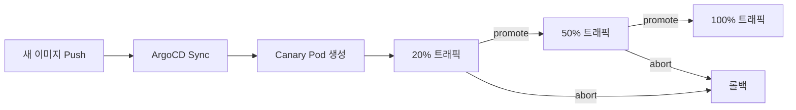

# HoppingMall

구매자와 판매자를 연결하는 온라인 쇼핑몰입니다. 상품 등록부터 주문, 결제, 포인트 적립, 쿠폰, 환불, 배송 추적, 정산까지 커머스 운영에 필요한 전체 흐름을 지원합니다.

[](https://codecov.io/gh/perArdua/hoppingmall)

## 서비스 구조


## 기술 스택

| 분류 | 기술 |
|------|------|
| Language | Kotlin, Java 21 |
| Framework | Spring Boot 3.5, Spring Cloud Gateway |
| DB | MySQL 8.0, H2 (테스트) |
| Messaging | Kafka (EOS, Transactional Outbox) |
| Cache | Redis Cluster (Redisson), Caffeine |
| Communication | gRPC, REST (Resilience4j Circuit Breaker) |
| Auth | JWT (Stateless), Role 기반 (BUYER/SELLER/ADMIN) |
| Infra | Docker Compose, Kind (K8s), Istio, ArgoCD, Argo Rollouts |
| Monitoring | Prometheus, Grafana, Loki, Zipkin |
| CI/CD | GitHub Actions, Canary 배포 (20% → 50% → 100%) |
| Test | JUnit5, Mockito, EmbeddedKafka, Jacoco (80%+) |

## 이벤트 흐름

주문부터 알림까지의 전체 이벤트 흐름입니다.


## 결제 보상 흐름

결제 실패 시 보상 트랜잭션 처리 흐름입니다.


## 도메인

```
user-service        회원, 인증, 멤버십 (등급별 적립률 1~7%)
product-service     상품, 카테고리, 재고, 리뷰, 위시리스트, 통계
order-service       주문, 장바구니, 환불, 배송
payment-service     결제, 포인트, 쿠폰, DLQ
notification-service 알림 (Kafka Consumer)
settlement-service  정산 (판매자 수익 집계)
api-gateway         라우팅, JWT 검증, Rate Limiting
```

## 로컬 실행

DB 비밀번호, 서비스 간 내부 토큰, 게이트웨이 신원 증명 값, JWT 서명 키, Grafana 관리자 비밀번호는 저장소에 두지 않습니다. 서비스 설정은 환경 변수만 읽고, 값이 없으면 기동하지 않습니다.

1. `.env.example`을 `.env`로 복사하고 값을 채웁니다. `.env`는 커밋하지 않습니다.
   - `MYSQL_ROOT_PASSWORD`: MySQL root 비밀번호. MySQL 컨테이너, 각 서비스의 docker 프로필 datasource, consistency-monitor, seed-runner가 같은 값을 씁니다.
   - `INTERNAL_SERVICE_TOKEN`: 서비스 간 내부 API·gRPC 호출 토큰. 모든 서비스가 같은 값을 써야 합니다.
   - `GATEWAY_IDENTITY_SECRET`: api-gateway가 토큰을 검증한 요청에 신원 헤더(`X-User-Id`·`x-user-role`)와 함께 붙이는 증명 값. 서비스는 이 값이 맞는 요청의 신원 헤더만 믿습니다. api-gateway와 모든 서비스가 같은 값을 써야 하고, docker·k8s 프로필에서는 값이 없으면 기동하지 않습니다.
   - `JWT_SECRET`: 토큰 서명 키. user-service가 서명하고 api-gateway와 consistency-monitor가 검증하므로 모든 서비스가 같은 값을 써야 합니다. HMAC-SHA256 키라 32바이트 이상이어야 합니다.
   - `GRAFANA_ADMIN_PASSWORD`: Grafana `admin` 계정 비밀번호. `scripts/verify-observability.sh`도 이 환경 변수를 읽습니다.
2. `docker compose up -d`로 띄웁니다. `docker-compose.yml`은 같은 폴더의 `.env`를 읽고, 필수 값이 비어 있으면 시작하지 않습니다.

- MySQL 볼륨(`mysql-data`)이 이미 있으면 root 비밀번호는 볼륨을 처음 만들 때의 값으로 남습니다. 값을 바꿨다면 볼륨을 새로 만들거나 MySQL에서 비밀번호를 바꿉니다.
- Grafana 볼륨(`grafana-data`)도 이미 있으면 관리자 비밀번호는 볼륨을 처음 만들 때의 값으로 남습니다.
- IDE에서 기본 프로필로 서비스를 띄울 때도 `INTERNAL_SERVICE_TOKEN` 환경 변수가 있어야 하고, api-gateway·user-service·consistency-monitor는 `JWT_SECRET`도 있어야 합니다. 기본 프로필에서 `GATEWAY_IDENTITY_SECRET`이 없으면 신원 헤더를 증명 없이 믿습니다. 테스트는 테스트 설정의 값을 쓰므로 환경 변수 없이 돕니다.
- 불변식 점검 스크립트(`scripts/invariants/check-*.sh`)는 `MYSQL_PASSWORD` 환경 변수가 있어야 실행됩니다.
- consistency-monitor의 위반 조회·해결 API(`/api/v1/violations/**`)는 ADMIN 액세스 토큰(`Authorization: Bearer ...`)이 있어야 하고, 해결한 사람은 토큰의 사용자 ID로 기록합니다. `/actuator/**`(헬스체크·Prometheus 수집)만 토큰 없이 열려 있습니다.
- Kind(K8s): `scripts/setup.sh`는 `JWT_SECRET`·`INTERNAL_SERVICE_TOKEN`·`GATEWAY_IDENTITY_SECRET`·`MYSQL_ROOT_PASSWORD`·`GRAFANA_ADMIN_PASSWORD` 환경 변수로 `hoppingmall-secret`을 만듭니다. 다섯 다 있어야 실행됩니다(예: `.env`에 다섯을 채운 뒤 `set -a && . ./.env && set +a && ./scripts/setup.sh`). Grafana는 이 시크릿의 `GRAFANA_ADMIN_PASSWORD`를 읽습니다.

## 시각 저장 규칙

MySQL과 앱 컨테이너는 시간대를 따로 정하지 않아 UTC이고, 서비스 datasource URL은 `serverTimezone=Asia/Seoul`입니다. 그래서 같은 DB 안에 기준이 다른 두 시각이 있습니다.

| 시각 | 기준 | 예 |
|------|------|------|
| 앱이 `LocalDateTime`으로 쓰는 열 | KST 벽시계 (JDBC가 Asia/Seoul로 바꿔 저장) | `created_at`, `updated_at`, `processed_at`, `expires_at` 등 엔티티 시각 |
| DB 함수 `NOW()`·`CURRENT_TIMESTAMP` | UTC (세션 시간대를 바꾸지 않은 경우) | `reservation_fence.created_at`(쓰기·정리 모두 `NOW(6)`) |

- 한 쿼리에서 두 기준을 섞지 않습니다. 앱이 쓴 시각 열과 비교할 기준 시각은 앱에서 `LocalDateTime`으로 만들어 파라미터로 넘깁니다. `NOW()`로 쓴 열은 `NOW()`와만 비교합니다.
- 앱이 쓴 시각 열을 SQL에서 `NOW()`와 비교해야 하는 도구는 세션 시간대를 KST로 맞춥니다(`SET time_zone = '+09:00'`). consistency-monitor(`spring.datasource.hikari.connection-init-sql`)와 `scripts/invariants/check-invariants.sh`(`--init-command`)가 이렇게 합니다.
- JDBC 시간대를 UTC로 바꾸면 이미 저장된 행이 9시간 밀려 읽히므로, 바꾸려면 기존 데이터 이전을 함께 해야 합니다.

## 스키마 관리

스키마는 Hibernate `ddl-auto`가 관리합니다(서비스는 `update`, 테스트는 `create-drop`). 마이그레이션 도구(Flyway 등)는 쓰지 않기로 했습니다.

- `update`는 새 표와 새 열은 만들지만, 기존 열의 타입 변경과 인덱스 변경은 일반적으로 반영하지 않습니다. 이런 변경이 든 PR은 본문에 적용할 SQL(`ALTER TABLE …`, `CREATE INDEX …`)을 적고, 기존 DB에는 그 SQL을 직접 적용합니다.
- 예외로 `@Column(length = …)`를 적은 문자열 열은 DB의 길이가 선언과 다르면 `update`가 기동할 때 그 열을 매핑 타입으로 `MODIFY`합니다. Hibernate 6.6은 MySQL `ENUM`과 `VARCHAR`를 같은 타입으로 보고 길이만 비교하기 때문입니다. 그래서 enum 필드가 `ENUM`으로 매핑되던 옛 코드에서는 `VARCHAR`로 바꿔 둔 열 가운데 길이를 적은 열(`dlq_messages.status`, `inventory_reservations.status`)이 기동할 때마다 `ENUM`으로 되돌려졌습니다(로그에 흔적 없음, binlog로 확인).
- enum 필드는 MySQL `ENUM` 열이 아니라 `VARCHAR` 열로 만듭니다: `@Enumerated(EnumType.STRING)` + `@JdbcTypeCode(SqlTypes.VARCHAR)` + `@Column(length = …)`. `ENUM` 열은 값 목록이 열 정의에 들어가 `update`가 새 값을 더하지 않으므로, 값을 추가하면 기존 DB에서 저장이 실패합니다. enum 열에는 CHECK 제약을 만들지 않으므로(테스트가 지킵니다) `VARCHAR` 열은 값 추가에 DB 변경이 필요 없습니다.
- 지금 코드에서는 기존 DB에 `ENUM` 열이 남아 있으면, 그 길이가 선언과 다르므로 `update`가 기동할 때 선언한 `VARCHAR`로 바꿉니다(값은 그대로).

## Canary 배포

Argo Rollouts + Istio 기반 Canary 배포를 지원합니다.




## 주요 패턴

- **Transactional Outbox** : 이벤트 발행 보장 (5초 주기 스케줄러)
- **Consumer 멱등성** : eventId 기반 중복 처리 방지 + DataIntegrityViolation catch
- **Saga (2-Phase Step Tracking)** : 분산 트랜잭션 보상 + crash recovery
- **DLQ** : DB 기반 Dead Letter Queue (자동 재시도, 지수 백오프)
- **CQRS** : 상품 도메인 Command/Query 서비스 분리
- **Pessimistic Locking** : 포인트 잔액, 재고 조작 시 비관적 락
- **Circuit Breaker + Retry** : Resilience4j 기반 서비스 간 장애 격리
