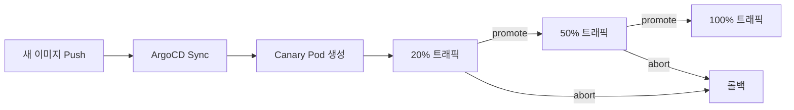

# HoppingMall

구매자와 판매자를 연결하는 온라인 쇼핑몰입니다. 상품 등록부터 주문, 결제, 포인트 적립, 쿠폰, 환불, 배송 추적, 정산까지 커머스 운영에 필요한 전체 흐름을 지원합니다.

[](https://codecov.io/gh/perArdua/hoppingmall)

## 서비스 구조


## 기술 스택

| 분류 | 기술 |
|------|------|
| Language | Kotlin, Java 21 |
| Framework | Spring Boot 3.5, Spring Cloud Gateway |
| DB | MySQL 8.0, H2 (테스트) |
| Messaging | Kafka (EOS, Transactional Outbox) |
| Cache | Redis Cluster (Redisson), Caffeine |
| Communication | gRPC, REST (Resilience4j Circuit Breaker) |
| Auth | JWT (Stateless), Role 기반 (BUYER/SELLER/ADMIN) |
| Infra | Docker Compose, Kind (K8s), Istio, ArgoCD, Argo Rollouts |
| Monitoring | Prometheus, Grafana, Loki, Zipkin |
| CI/CD | GitHub Actions, Canary 배포 (20% → 50% → 100%) |
| Test | JUnit5, Mockito, EmbeddedKafka, Jacoco (80%+) |

## 이벤트 흐름

주문부터 알림까지의 전체 이벤트 흐름입니다.


## 결제 보상 흐름

결제 실패 시 보상 트랜잭션 처리 흐름입니다.


## 도메인

```
user-service        회원, 인증, 멤버십 (등급별 적립률 1~7%)
product-service     상품, 카테고리, 재고, 리뷰, 위시리스트, 통계
order-service       주문, 장바구니, 환불, 배송
payment-service     결제, 포인트, 쿠폰, DLQ
notification-service 알림 (Kafka Consumer)
settlement-service  정산 (판매자 수익 집계)
api-gateway         라우팅, JWT 검증, Rate Limiting
```

## 로컬 실행

DB 비밀번호와 서비스 간 내부 토큰은 저장소에 두지 않습니다. 서비스 설정은 환경 변수만 읽고, 값이 없으면 기동하지 않습니다.

1. `.env.example`을 `.env`로 복사하고 값을 채웁니다. `.env`는 커밋하지 않습니다.
   - `MYSQL_ROOT_PASSWORD`: MySQL root 비밀번호. MySQL 컨테이너, 각 서비스의 docker 프로필 datasource, consistency-monitor, seed-runner가 같은 값을 씁니다.
   - `INTERNAL_SERVICE_TOKEN`: 서비스 간 내부 API·gRPC 호출 토큰. 모든 서비스가 같은 값을 써야 합니다.
   - `JWT_SECRET`(선택): 비우면 compose의 개발용 값을 씁니다.
2. `docker compose up -d`로 띄웁니다. `docker-compose.yml`은 같은 폴더의 `.env`를 읽고, 필수 값이 비어 있으면 시작하지 않습니다.

- MySQL 볼륨(`mysql-data`)이 이미 있으면 root 비밀번호는 볼륨을 처음 만들 때의 값으로 남습니다. 값을 바꿨다면 볼륨을 새로 만들거나 MySQL에서 비밀번호를 바꿉니다.
- IDE에서 기본 프로필로 서비스를 띄울 때도 `INTERNAL_SERVICE_TOKEN` 환경 변수가 있어야 합니다. 테스트는 테스트 설정의 값을 쓰므로 환경 변수 없이 돕니다.
- Kind(K8s): `scripts/setup.sh`는 `JWT_SECRET`·`INTERNAL_SERVICE_TOKEN`·`MYSQL_ROOT_PASSWORD` 환경 변수로 `hoppingmall-secret`을 만듭니다. 셋 다 있어야 실행됩니다(예: `.env`에 셋을 채운 뒤 `set -a && . ./.env && set +a && ./scripts/setup.sh`).

## Canary 배포

Argo Rollouts + Istio 기반 Canary 배포를 지원합니다.




## 주요 패턴

- **Transactional Outbox** : 이벤트 발행 보장 (5초 주기 스케줄러)
- **Consumer 멱등성** : eventId 기반 중복 처리 방지 + DataIntegrityViolation catch
- **Saga (2-Phase Step Tracking)** : 분산 트랜잭션 보상 + crash recovery
- **DLQ** : DB 기반 Dead Letter Queue (자동 재시도, 지수 백오프)
- **CQRS** : 상품 도메인 Command/Query 서비스 분리
- **Pessimistic Locking** : 포인트 잔액, 재고 조작 시 비관적 락
- **Circuit Breaker + Retry** : Resilience4j 기반 서비스 간 장애 격리
