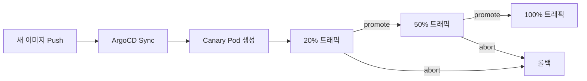

# HoppingMall

구매자와 판매자를 연결하는 온라인 쇼핑몰입니다. 상품 등록부터 주문, 결제, 포인트 적립, 쿠폰, 환불, 배송 추적, 정산까지 커머스 운영에 필요한 전체 흐름을 지원합니다.

[](https://codecov.io/gh/perArdua/hoppingmall)

## 서비스 구조


## 기술 스택

| 분류 | 기술 |
|------|------|
| Language | Kotlin, Java 21 |
| Framework | Spring Boot 3.5, Spring Cloud Gateway |
| DB | MySQL 8.0, H2 (테스트) |
| Messaging | Kafka (EOS, Transactional Outbox) |
| Cache | Redis Cluster (Redisson), Caffeine |
| Communication | gRPC, REST (Resilience4j Circuit Breaker) |
| Auth | JWT (Stateless), Role 기반 (BUYER/SELLER/ADMIN) |
| Infra | Docker Compose, Kind (K8s), Istio, ArgoCD, Argo Rollouts |
| Monitoring | Prometheus, Grafana, Loki, Zipkin |
| CI/CD | GitHub Actions, Canary 배포 (20% → 50% → 100%) |
| Test | JUnit5, Mockito, EmbeddedKafka, Jacoco (80%+) |

## 이벤트 흐름

주문부터 알림까지의 전체 이벤트 흐름입니다.


## 결제 보상 흐름

결제 실패 시 보상 트랜잭션 처리 흐름입니다.


## 도메인

```
user-service        회원, 인증, 멤버십 (등급별 적립률 1~7%)
product-service     상품, 카테고리, 재고, 리뷰, 위시리스트, 통계
order-service       주문, 장바구니, 환불, 배송
payment-service     결제, 포인트, 쿠폰, DLQ
notification-service 알림 (Kafka Consumer)
settlement-service  정산 (판매자 수익 집계)
api-gateway         라우팅, JWT 검증, Rate Limiting
```

## 로컬 실행

DB 비밀번호, 서비스 간 내부 토큰, 게이트웨이 신원 증명 값, JWT 서명 키, Grafana 관리자 비밀번호는 저장소에 두지 않습니다. 서비스 설정은 환경 변수만 읽고, 값이 없으면 기동하지 않습니다.

1. `.env.example`을 `.env`로 복사하고 값을 채웁니다. `.env`는 커밋하지 않습니다.
   - `MYSQL_ROOT_PASSWORD`: MySQL root 비밀번호. MySQL 컨테이너, 각 서비스의 docker 프로필 datasource, consistency-monitor, seed-runner가 같은 값을 씁니다.
   - `INTERNAL_SERVICE_TOKEN`: 서비스 간 내부 API·gRPC 호출 토큰. 모든 서비스가 같은 값을 써야 합니다.
   - `GATEWAY_IDENTITY_SECRET`: api-gateway가 토큰을 검증한 요청에 신원 헤더(`X-User-Id`·`x-user-role`)와 함께 붙이는 증명 값. 서비스는 이 값이 맞는 요청의 신원 헤더만 믿습니다. api-gateway와 모든 서비스가 같은 값을 써야 하고, docker·k8s 프로필에서는 값이 없으면 기동하지 않습니다.
   - `JWT_SECRET`: 토큰 서명 키. user-service가 서명하고 api-gateway와 consistency-monitor가 검증하므로 모든 서비스가 같은 값을 써야 합니다. HMAC-SHA256 키라 32바이트 이상이어야 합니다.
   - `GRAFANA_ADMIN_PASSWORD`: Grafana `admin` 계정 비밀번호. `scripts/verify-observability.sh`도 이 환경 변수를 읽습니다.
2. `docker compose up -d`로 띄웁니다. `docker-compose.yml`은 같은 폴더의 `.env`를 읽고, 필수 값이 비어 있으면 시작하지 않습니다.

- MySQL 볼륨(`mysql-data`)이 이미 있으면 root 비밀번호는 볼륨을 처음 만들 때의 값으로 남습니다. 값을 바꿨다면 볼륨을 새로 만들거나 MySQL에서 비밀번호를 바꿉니다.
- Grafana 볼륨(`grafana-data`)도 이미 있으면 관리자 비밀번호는 볼륨을 처음 만들 때의 값으로 남습니다.
- IDE에서 기본 프로필로 서비스를 띄울 때도 `INTERNAL_SERVICE_TOKEN` 환경 변수가 있어야 하고, api-gateway·user-service·consistency-monitor는 `JWT_SECRET`도 있어야 합니다. 기본 프로필에서 `GATEWAY_IDENTITY_SECRET`이 없으면 신원 헤더를 증명 없이 믿습니다. 테스트는 테스트 설정의 값을 쓰므로 환경 변수 없이 돕니다.
- 불변식 점검 스크립트(`scripts/invariants/check-*.sh`)는 `MYSQL_PASSWORD` 환경 변수가 있어야 실행됩니다.
- consistency-monitor의 위반 조회·해결 API(`/api/v1/violations/**`)는 ADMIN 액세스 토큰(`Authorization: Bearer ...`)이 있어야 하고, 해결한 사람은 토큰의 사용자 ID로 기록합니다. `/actuator/**`(헬스체크·Prometheus 수집)만 토큰 없이 열려 있습니다.
- Kind(K8s): `scripts/setup.sh`는 `JWT_SECRET`·`INTERNAL_SERVICE_TOKEN`·`GATEWAY_IDENTITY_SECRET`·`MYSQL_ROOT_PASSWORD`·`GRAFANA_ADMIN_PASSWORD` 환경 변수로 `hoppingmall-secret`을 만듭니다. 다섯 다 있어야 실행됩니다(예: `.env`에 다섯을 채운 뒤 `set -a && . ./.env && set +a && ./scripts/setup.sh`). Grafana는 이 시크릿의 `GRAFANA_ADMIN_PASSWORD`를 읽습니다.

## 시각 저장 규칙

MySQL과 앱 컨테이너는 시간대를 따로 정하지 않아 UTC이고, 서비스 datasource URL은 `serverTimezone=Asia/Seoul`입니다. 그래서 같은 DB 안에 기준이 다른 두 시각이 있습니다.

| 시각 | 기준 | 예 |
|------|------|------|
| 앱이 `LocalDateTime`으로 쓰는 열 | KST 벽시계 (JDBC가 Asia/Seoul로 바꿔 저장) | `created_at`, `updated_at`, `processed_at`, `expires_at` 등 엔티티 시각 |
| DB 함수 `NOW()`·`CURRENT_TIMESTAMP` | UTC (세션 시간대를 바꾸지 않은 경우) | `reservation_fence.created_at`(쓰기·정리 모두 `NOW(6)`) |

- 한 쿼리에서 두 기준을 섞지 않습니다. 앱이 쓴 시각 열과 비교할 기준 시각은 앱에서 `LocalDateTime`으로 만들어 파라미터로 넘깁니다. `NOW()`로 쓴 열은 `NOW()`와만 비교합니다.
- 앱이 쓴 시각 열을 SQL에서 `NOW()`와 비교해야 하는 도구는 세션 시간대를 KST로 맞춥니다(`SET time_zone = '+09:00'`). consistency-monitor(`spring.datasource.hikari.connection-init-sql`)와 `scripts/invariants/check-invariants.sh`(`--init-command`)가 이렇게 합니다.
- JDBC 시간대를 UTC로 바꾸면 이미 저장된 행이 9시간 밀려 읽히므로, 바꾸려면 기존 데이터 이전을 함께 해야 합니다.

## 스키마 관리

스키마는 Hibernate `ddl-auto`가 관리합니다(서비스는 `update`, 테스트는 `create-drop`). 마이그레이션 도구(Flyway 등)는 쓰지 않기로 했습니다.

- `update`는 새 표와 새 열은 만들지만, 기존 DB의 열 타입·길이 변경과 인덱스 변경은 자동으로 반영하지 않습니다. 이런 변경이 든 PR은 본문에 적용할 SQL(`ALTER TABLE …`, `CREATE INDEX …`)을 적고, 기존 DB에는 그 SQL을 직접 적용합니다.
- enum 필드는 MySQL `ENUM` 열이 아니라 `VARCHAR` 열로 만듭니다: `@Enumerated(EnumType.STRING)` + `@JdbcTypeCode(SqlTypes.VARCHAR)` + `@Column(length = …)`. `ENUM` 열은 값 목록이 열 정의에 들어가 `update`가 새 값을 더하지 않으므로, 값을 추가하면 기존 DB에서 저장이 실패합니다. `VARCHAR` 열은 값 추가에 DB 변경이 필요 없습니다.

## Canary 배포

Argo Rollouts + Istio 기반 Canary 배포를 지원합니다.




## 주요 패턴

- **Transactional Outbox** : 이벤트 발행 보장 (5초 주기 스케줄러)
- **Consumer 멱등성** : eventId 기반 중복 처리 방지 + DataIntegrityViolation catch
- **Saga (2-Phase Step Tracking)** : 분산 트랜잭션 보상 + crash recovery
- **DLQ** : DB 기반 Dead Letter Queue (자동 재시도, 지수 백오프)
- **CQRS** : 상품 도메인 Command/Query 서비스 분리
- **Pessimistic Locking** : 포인트 잔액, 재고 조작 시 비관적 락
- **Circuit Breaker + Retry** : Resilience4j 기반 서비스 간 장애 격리

## 그대로 두기로 한 것

알고 있지만 지금 구성(서비스마다 인스턴스 1개, compose·Kind 실행)에서는 고치지 않기로 한 것입니다. 항목마다 무엇이 남는지, 왜 그대로 두는지, 언제 다시 봐야 하는지 적습니다.

- **인스턴스 사이 L1 캐시 무효화 없음** (#756): 2단계 캐시의 L1(프로세스 메모리)은 변경을 다른 인스턴스에 알리지 않아, 인스턴스가 여럿이면 다른 인스턴스가 옛 값을 L1 TTL까지 돌려줍니다. compose와 k8s 매니페스트 모두 서비스당 1개(`replicas: 1`)라 지금은 생기지 않습니다. 인스턴스를 2개 이상으로 늘리기 전에 Redis pub/sub 등으로 무효화를 전파해야 합니다.
- **기본 꺼짐인 기능 스위치** (#716·#728·#898): `order.reservation.fence.enabled`·`inventory.link-check.enabled`·`inventory.mode=bucket`·`dlq.archival.enabled`는 기본이 꺼짐(`single`)이고 compose·k8s 어디서도 켜지 않습니다. 실험·선택 기능이라 테스트에서만 켭니다. 켤 때는 테스트가 보는 조합대로 켜고, 링크 확인은 bucket 모드에서만 켤 수 있습니다.
- **MinIO 없이는 DLQ 퍼지 대상 0** (#893): DLQ 퍼지는 보관(`archived_at`)된 행만 지우는데, 보관은 `dlq.archival.enabled`와 MinIO가 있어야 동작합니다. compose·k8s에 MinIO가 없어 처리 끝난 DLQ 행은 지워지지 않고 쌓입니다. DLQ 표가 커지면 보관을 켜거나 퍼지 조건을 바꿉니다.
- **멱등성 락의 최대 30초** (#797): `@Idempotent` 처리 중 락은 Redisson watchdog이 처리 시간만큼 연장합니다. 처리 중 인스턴스가 죽으면 watchdog 기본값(30초)이 지날 때까지 같은 키의 요청은 409 `IDEM002`로 거절됩니다. 클라이언트가 30초 안에 같은 키로 다시 보내야 하는 흐름이 생기면 다시 봅니다.
- **로그인 시도 제한으로 남의 계정을 막을 수 있음** (#845·#849): 같은 이메일로 15분 안에 10번 틀리면 그 계정의 로그인을 15분 막습니다(429, `Retry-After`). 남이 일부러 10번 틀려 계정 주인을 15분 막을 수 있지만, 여러 IP로 한 계정을 노리는 대입을 막는 쪽을 골랐습니다. 이런 신고가 생기면 추가 인증 단계 같은 다른 방법을 봅니다.
- **쿠폰 정합성 스윕의 남는 틈** (#861·#882): 스윕은 Redis에 예약한 지 5분(`coupon.reconciliation.min-reservation-age-ms`)이 지난 사용자만 복원합니다. 스윕이 예약 시각을 읽은 뒤 복원하기 전 수 ms 사이에 그 사용자가 복원되고 다시 예약하면 새 예약을 복원할 수 있습니다. 발급이 몰리는 쿠폰에서 재고가 어긋나면 다시 봅니다.
- **확정(CONFIRMED) 예약 행은 지우지 않음** (#864): 예약 정리 작업은 끝난 지 30일 지난 CANCELLED·EXPIRED 행만 지웁니다. 결제된 주문을 취소할 때 기한 없이 CONFIRMED 행을 다시 읽어 재고를 되돌리므로 지우지 않습니다. 표가 커지면 취소 가능 기한을 정한 뒤 그보다 오래된 행을 지웁니다.
- **관리자 DLQ 일괄 재처리의 잠금** (#798): 토픽별 일괄 재처리는 한 트랜잭션에서 최대 50건을 차례로 선점해 끝날 때까지 잠급니다. 관리자가 손으로 하는 작업이라 그대로 둡니다. 자동 재처리와 겹쳐 잠금 대기가 보이면 건마다 트랜잭션을 나눕니다.
- **역보상이 재시도를 먼저 다 쓰는 경우** (#878): product 통계 DLQ에서 판매 통계가 오래 실패하면(order 장시간 다운) 뒤따르는 역보상·취소 통계가 재시도 3번을 먼저 써서 FAILED가 될 수 있습니다. 그때는 판매 통계부터 차례로 손으로 재처리합니다. 자주 생기면 순서를 기다리는 동안 재시도 횟수를 쓰지 않게 바꿉니다.
- **consistency-monitor** (#884): 점검 주기에 분산 잠금이 없어 한 인스턴스로만 띄웁니다(compose 1개, `127.0.0.1`에만 열림, k8s 매니페스트 없음). 위반 API는 ADMIN 토큰을 검증하지만 게이트웨이의 로그아웃 목록(Redis)은 보지 않아, 로그아웃한 토큰도 만료(1시간)까지 통합니다. 외부에 열거나 여러 개 띄우게 되면 다시 봅니다.
- **신원 헤더 증명** (#887): `GATEWAY_IDENTITY_SECRET`은 한 값만 받으므로 값을 바꾸려면 게이트웨이와 모든 서비스를 함께 재시작해야 합니다. IDE 기본 프로필에서 값이 없으면 검사를 끄고 신원 헤더를 그대로 믿습니다(docker·k8s 프로필은 값이 없으면 기동하지 않음). 무중단 회전이 필요해지면 두 값을 함께 받게 합니다.
- **마이그레이션 도구 없음** (#766·#874): Flyway 없이 `ddl-auto: update`로 스키마를 관리하고, 기존 DB에는 PR 본문의 SQL을 직접 적용합니다("스키마 관리"). 운영 DB가 생기면 도입을 다시 봅니다.
- **DB 시각의 두 기준** (#804): 앱이 쓰는 열은 KST 벽시계, `NOW()`는 UTC이고 한 쿼리에서 섞지 않습니다("시각 저장 규칙"). JDBC 시간대를 바꾸려면 기존 데이터 이전을 함께 해야 합니다.
- **프록시 뒤 IP** (#734·#785·#787): 요청 제한의 IP 키는 믿는 프록시 단수(`gateway.rate-limit.trusted-proxy-count`·`user.rate-limit.trusted-proxy-count`)가 기본 0이라 연결 주소를 씁니다. 앞에 로드밸런서·Ingress를 두면 모든 요청이 그 주소 하나로 묶이므로, 그 단수만큼 값을 정해야 합니다.
- **브랜치 보호** (#773): develop의 필수 CI 검사·PR 필수 규칙은 코드가 아니라 저장소 설정이라 이 저장소의 파일로는 고칠 수 없습니다. 저장소 관리자가 설정합니다.
